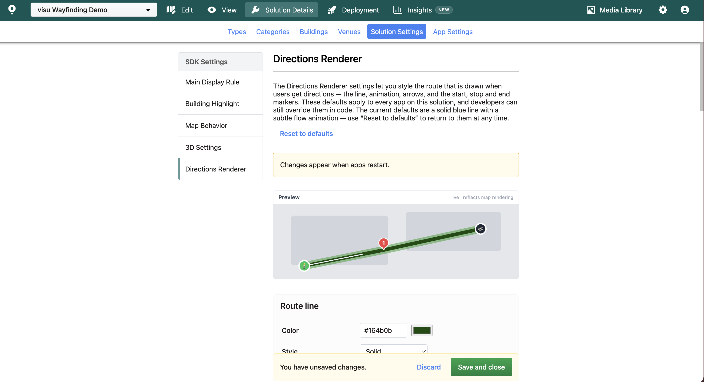
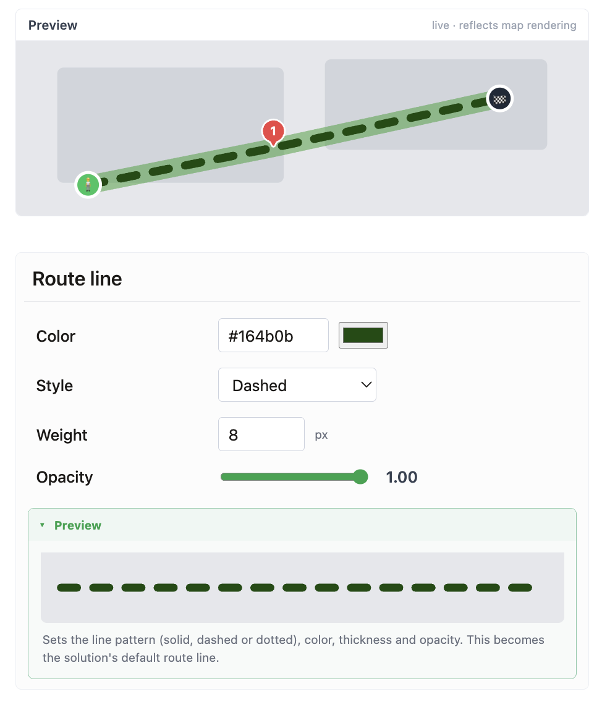
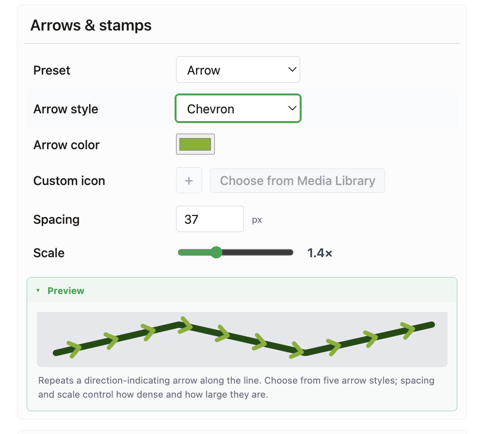
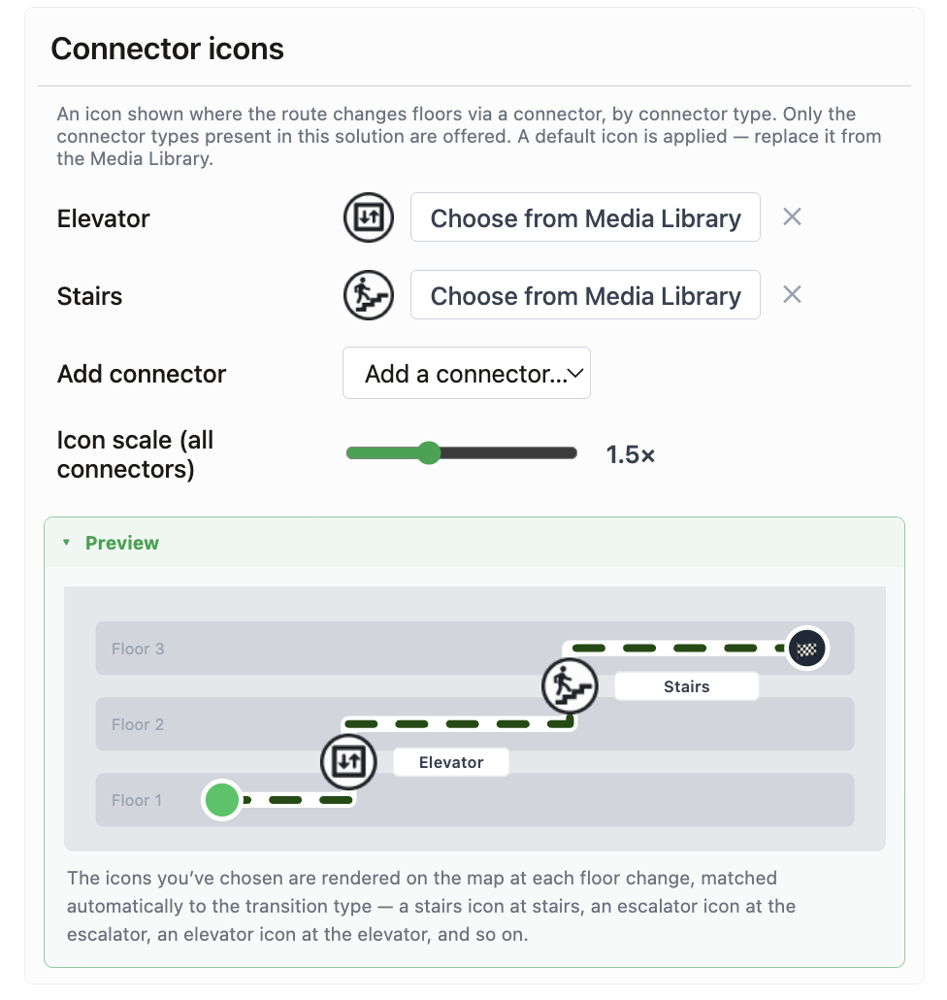

# Directions Renderer

The Directions Renderer section controls how a calculated **route** looks on the map — the directions line that guides a visitor from A to B, together with its animation, direction arrows, and the markers and icons drawn along it. Just as Display Rules govern how Locations appear, Directions Renderer styling governs how a route appears.

Style your route **once** here, and every app built on the Solution — the MapsIndoors Web App, the Map Template, and your own custom integrations — picks it up automatically, with no code changes. If you configure nothing, routes keep the built-in default look: a solid blue line, 4 px wide, with a flowing animation that shows the direction of travel.

Navigate from **Solution Details → Solution Settings → Directions Renderer**. Each setting shows a **live preview** as you edit, so you can see the result before saving.

<figure><figcaption></figcaption></figure>


Route styling is read by an app **once, when it loads**. After you save a change here, running apps pick it up on their next page load, and the Solution data may be cached in the browser for up to \~12 hours — so allow up to half a day for a change to reach every app.


## Route line

The path drawn along the route.

1. **Color** — the line color, as a 6-digit HEX value (e.g. `#3071D9`). Default `#3071D9` (blue).
2. **Style** — `Solid`, `Dashed`, or `Dotted`. Default `Solid`.
3. **Width** — line thickness in pixels, from `0.5` to `24`. Default `4`.
4. **Opacity** — from `0` (transparent) to `1` (opaque). Default `1`.

<figure><figcaption></figcaption></figure>

## Halo

An optional contrasting outline drawn beneath the line, so the route stays readable over busy floor plans. Off by default. When enabled, the halo adds its width to **each side** of the line, so the total drawn width is the line width plus twice the halo width.

1. **Enable halo** — off by default.
2. **Color** — 6-digit HEX. Default `#FFFFFF` (white).
3. **Width** — per side, in pixels, from `0.5` to `24`. Default `2`.
4. **Opacity** — from `0` to `1`. Default `1`.

## Animation

A moving overlay along the line that shows the direction of travel.

1. **Type** — `Flow` (default), `Pulse`, `Comet`, or `None`.
2. **Speed** — travel speed of the animation in screen pixels per second, so it reads the same at every zoom level. From `10` to `3000`. Default `300`.
3. **Minimum duration** — the shortest time the animation takes to cross one leg of the route, in seconds, from `0` to `30`. Default `1.2`. This keeps very short legs from animating too fast to see.
4. **Force animation** — by default the animation stops when the visitor's device asks for reduced motion. Turn this on to keep it running regardless — intended for kiosks and signage, where the moving line _is_ the directional cue.
5. **Overlay color / width / opacity** — the moving overlay's own color (6-digit HEX, default `#EFF4FB`), width (`0.5`–`24`, default `2`), and opacity (`0`–`1`, default `1`).

## Direction arrows

A small marker repeated along the line to reinforce the direction of travel. Choose from a dropdown:

* **None** — no arrows or stamps (the default).
* **Arrow** — a built-in arrow, in one of five styles and any color.
* **Custom** — any icon from your Media Library, repeated along the line.

<figure><figcaption></figcaption></figure>

When **Arrow** is selected, pick the shape and color:

1. **Arrow style** — `Chevron` (default), `Double chevron`, `Triangle`, `Arrow`, or `Dart`.
2. **Color** — the arrow tint, as a 6-digit HEX value. Default `#FFFFFF` (white).

When **Custom** is selected, choose an icon from the Media Library instead; the arrow style and color no longer apply.

To get the result you expect from a custom stamp, design the icon for how it renders: the image is repeated along the line and **rotated to follow the direction of travel, with the icon's right-hand side pointing forward** — so draw it **pointing right (→)**, like the built-in arrows. Because it rotates with the route (not the screen), it will appear sideways or upside-down on legs heading left or down — choose a shape that reads at any angle (arrow-like, no text or logos). The **Color** field does not recolor a custom icon, so bake the color into the file, and use a transparent background.

For either choice, control the placement and size:

3. **Spacing** — distance between arrows/stamps along the line, in pixels, from `8` to `200`. Default `24`.
4. **Scale** — size multiplier on the base 24 px icon, from `0.2` to `4`. Default `1`.


A **custom** stamp icon renders on Mapbox only. On a Google Maps solution it falls back to the built-in arrow. The five built-in arrow styles render the same on both engines.


## Stop icons

The markers shown at each stop on a multi-stop route.

1. **Numbered** — show the stop number inside the marker. On by default.
2. **Color** — marker fill color, 6-digit HEX. Default `#EF4444` (red).
3. **Custom icon** — optionally replace the built-in pin with an icon from the Media Library.
4. **Scale** — size multiplier on the base 24 px icon, from `0.2` to `4`. Default `1`.

## Floor-change (connector) icons

The icons shown where a route changes floor — at an elevator, escalator, stairs, and so on. Assign an icon from the Media Library per connector type (`Elevator`, `Escalator`, `Stairs`, `Ramp`, `Wheelchair ramp`, `Wheelchair lift`, `Ladder`, and an `All other connectors` fallback). Adding one of the named connector types automatically applies a default glyph, which you can then replace; the `All other connectors` fallback has no built-in glyph and stays whatever you choose.

1. **Icon per type** — one Media-Library icon per connector type.
2. **Scale** — a shared size multiplier for all connector icons, from `0.2` to `4`. Default `1`.

<figure><figcaption></figcaption></figure>

## Start and end markers

Markers at the very start (origin) and end (destination) of the route. Nothing is drawn at the route ends unless you configure it. Each of the **Start** and **End** markers has:

1. **Icon** — an icon from the Media Library.
2. **Label** — optional text shown next to the marker.
3. **Show label** — on by default.
4. **Zoom range** — optional `from`/`to` zoom levels (`1`–`24`) that limit when the marker is visible.
5. **Scale** — size multiplier on the base 24 px icon, from `0.2` to `4`. Default `1`.

## Camera

1. **Maximum fit zoom** — when the map zooms to fit a new route, this caps how far it will zoom in, from `1` to `24`. Leave empty for no extra cap.

## 3D elevated line (Mapbox)

Lifts the route line off the floor so it stands out in a tilted, 3D view.

1. **Elevated** — off by default.
2. **Height** — how far the line is lifted, in meters, from `0` to `10`. Default `0.3`.


The 3D elevated line renders on **Mapbox** only, and is only visible when the map is tilted (pitched). On Google Maps the route stays flat. A small height such as the `0.3 m` default reads as flat — raise it toward the maximum of `10 m` to see the effect clearly.



**Choosing custom icons (arrows, stops, connectors, start/end markers).** Icons always render at a fixed **24 px base × their Scale** — resizing the source image does not change how big it draws; use the Scale field for that. For the source file:

* **SVG** is the best choice — it stays crisp at every scale and screen.
* **PNG** should be **square, on a transparent background**, and at least **3× the largest size you'll display** — 72×72 px for scale 1, up to 288×288 px for the maximum scale 4. When in doubt, a 512×512 px source is always safe; icons are automatically served resized to fit the screen, so a large source costs nothing, while a too-small one is upscaled and looks blurry.
* **Non-square images** are fitted inside the square icon box, so they render smaller along one side — crop the source square for best results.



All colour fields here take **6-digit HEX** values (`#RRGGBB`) — colour names, `rgb()`, and alpha are not accepted; opacity is always its own separate `0`–`1` field. Custom icons must be uploaded to your Media Library.

