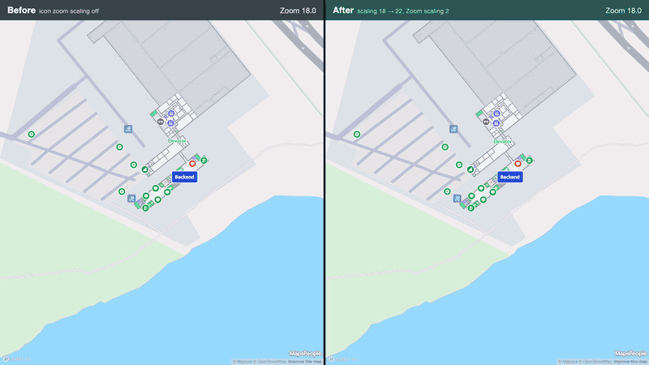
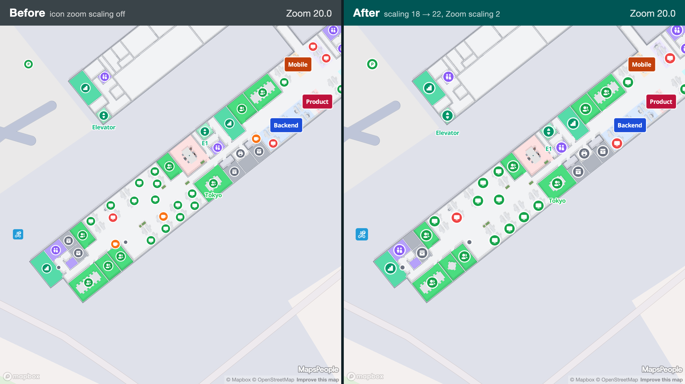
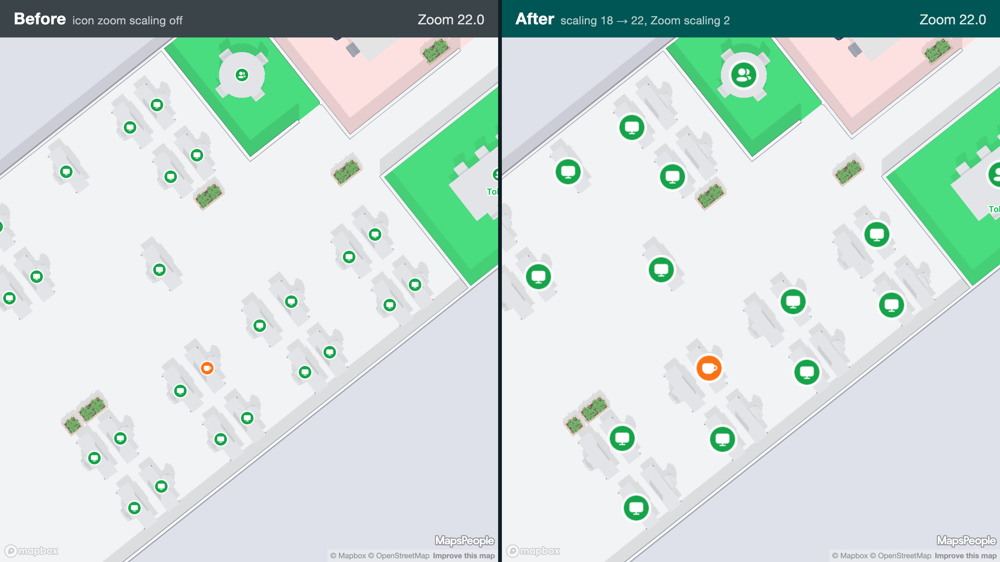
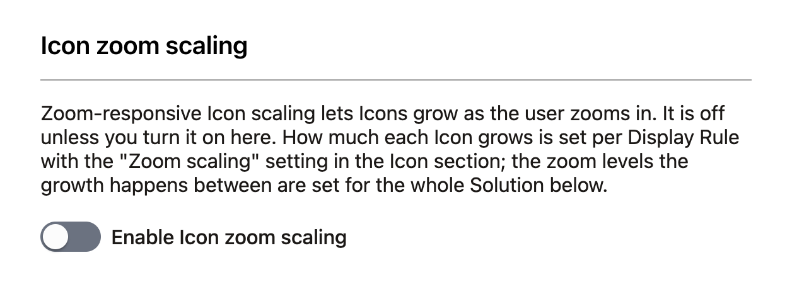
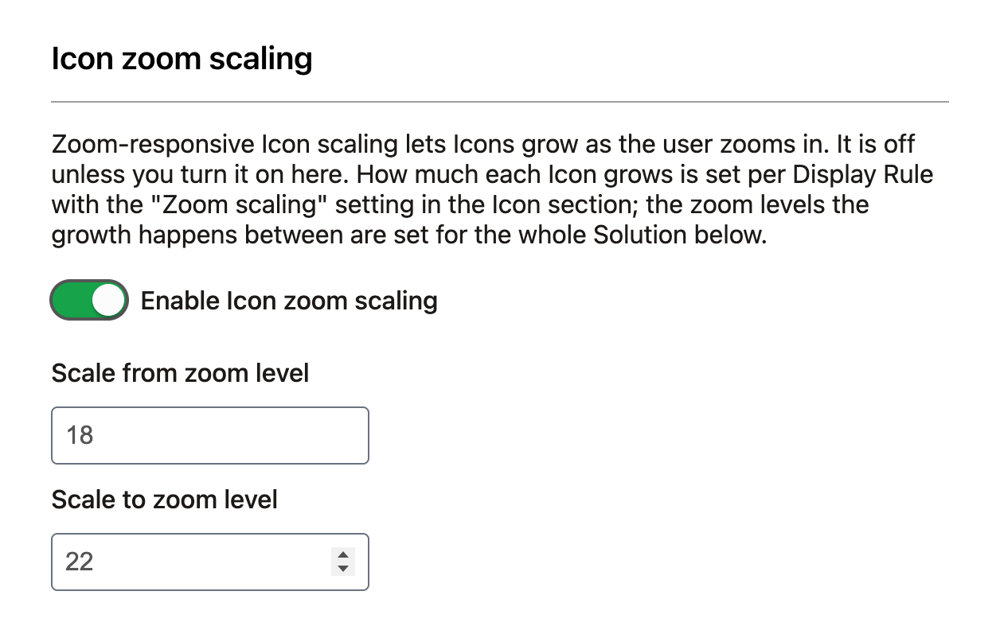
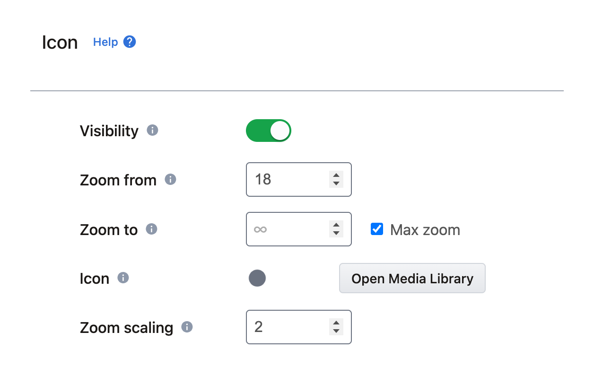
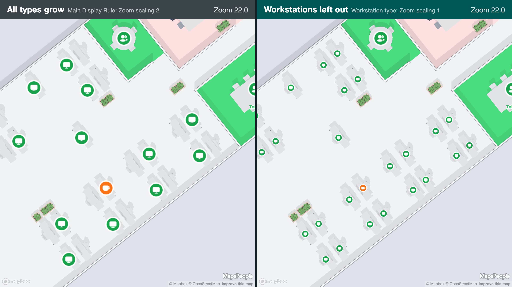

# Icon Zoom Scaling

## Introduction

By default, a Location's Icon stays the same size on screen at every zoom level. When users zoom far in, Rooms and Areas get big while the Icons stay small, so the Icons can look lost on the map.

With **Icon zoom scaling**, Icons grow gradually as the user zooms in, between two zoom levels you choose. Below the first zoom level, Icons have their normal size. At and above the second, they reach their full size: the normal size multiplied by the **Zoom scaling** value of their Display Rule.

<figure><figcaption>
Left: Icon zoom scaling off. Right: scaling from zoom level 18 to 22 with Zoom scaling 2.
</figcaption></figure>


Icon zoom scaling works on **Mapbox** maps only. On Google Maps Solutions the settings are hidden in the CMS, and the SDKs ignore them.


## Requirements

* A Solution that uses **Mapbox**.
* An app on an SDK version that supports Icon zoom scaling:

| Platform    | First version |
| ----------- | ------------- |
| Web SDK     | 4.62.0        |
| iOS SDK     | 4.23.0        |
| Android SDK | 4.23.0        |

Older SDK versions ignore the settings, so you can configure Icon zoom scaling before every app has been updated. Nothing changes on the map until an app uses a supported version.

## How Icons grow

Icons grow slowly at first and faster near the end of the zoom range. With a range from 18 to 22 and Zoom scaling 2:

| Zoom level | 18 and below | 19    | 20   | 21    | 22 and above |
| ---------- | ------------ | ----- | ---- | ----- | ------------ |
| Icon size  | 1×           | 1.07× | 1.2× | 1.47× | 2×           |

<figure><figcaption>
Zoom level 20: Icons are 1.2× their normal size.
</figcaption></figure>

<figure><figcaption>
Zoom level 22: Icons have reached their full size, 2× their normal size.
</figcaption></figure>

Labels move outwards as their Icon grows, so they don't end up underneath it.

## Turn on Icon zoom scaling

Icon zoom scaling is off by default. Existing Solutions look exactly as before until you turn it on.

1. Open **Solution Details → Solution Settings → Map Behavior**.
2. In the **Icon zoom scaling** section, switch on **Enable Icon zoom scaling**.

<figure><figcaption>
The Icon zoom scaling section in Map Behavior
</figcaption></figure>

3. Set the zoom range:
   * **Scale from zoom level**: where Icons start to grow. We suggest 18.
   * **Scale to zoom level**: where Icons reach their full size. We suggest 22.
4. Click **Save and close**.

<figure><figcaption>
Icon zoom scaling switched on, growing Icons from zoom level 18 to 22
</figcaption></figure>

Both zoom levels must be between 1 and 24, and "Scale to zoom level" must be larger than "Scale from zoom level". The zoom range applies to the whole Solution.

## Choose how much Icons grow

How much an Icon grows is set by the **Zoom scaling** setting in the **Icon** section of the [Display Rule](../display-rules.md) editor.

<figure><figcaption>
Zoom scaling set to 2 on the Main Display Rule
</figcaption></figure>

| Zoom scaling | Icon size at the end of the zoom range |
| ------------ | -------------------------------------- |
| 1            | Normal size (no growth)                |
| 1.5          | 1.5× normal size                       |
| 2            | Twice the normal size                  |
| 4            | Four times the normal size (maximum)   |

Values between 0 and 1 make Icons **shrink** as the user zooms in, which is rarely what you want.

Zoom scaling follows the usual [Display Rule hierarchy](../display-rules.md#display-rule-hierarchy):

1. **Main Display Rule** (Solution Settings → Main Display Rule): the default for every Location.
2. **Location Type**: overrides the Main Display Rule for all Locations of that Type.
3. **Location**: overrides its Type.

On a Location Type or a Location, the setting is inherited (locked) until you unlock it and set a value. From a Location's Display Rule you can push the value to its Location Type.


A good starting point: set Zoom scaling on the **Main Display Rule** (for example 2), then adjust individual Location Types where needed.


## Leave some Location Types out

Some Location Types shouldn't grow, or should grow less. This is typical for dense Types such as desks or parking spaces, where bigger Icons would overlap.

* **Leave a Type out:** open the Location Type's Display Rule, unlock **Zoom scaling** and set it to **1**. Its Icons keep their normal size at every zoom level, while all other Types still grow.
* **Make a Type grow less:** set a value between 1 and the Main Display Rule's value, for example 1.5 when the Main Display Rule has 2.
* **A single Location:** do the same on that Location's Display Rule.

<figure><figcaption>
Zoom level 22. Left: every Type grows. Right: the workstation Type has Zoom scaling 1, so only the other Types grow.
</figcaption></figure>

The zoom range is the same for every Location Type. Only how much each Type grows can differ.

## Overlapping Icons

Bigger Icons take up more space, so nearby Icons are more likely to overlap at high zoom levels. What happens then depends on the Solution's **Collision Handling** setting in **Map Behavior**: overlapping Icons or their Labels may be hidden. In dense areas, this means some Icons can disappear as they grow. You can see this in the zoom level 22 image above, where some workstation Icons are hidden on the right.

If this is a problem for a Location Type, lower its Zoom scaling (for example to 1.5), or set it to 1 to leave it out.

## Other things to know

* **Labels** move outwards as their Icon grows. They move in small steps at whole zoom levels rather than perfectly smoothly.
* **Badges** grow with their Icon. A badge shown without an Icon keeps its normal size.
* **Selected and hovered** Locations keep their usual selection marker and hover enlargement, on top of the zoom growth.
* **Sharpness:** Icons are enlarged from their normal-size image, so at high Zoom scaling values (3 to 4) they can look slightly soft. Upload Icons at a higher resolution if you plan to use high values.

## Turn off Icon zoom scaling

Switch off **Enable Icon zoom scaling** in **Map Behavior** and click **Save and close**. Maps go back to normal-size Icons the next time they load the Solution's data. The Zoom scaling values on your Display Rules are kept, so turning Icon zoom scaling on again restores the same setup.

## For developers

Apps don't need any code changes: the SDKs read the zoom range and the Zoom scaling values from the CMS and scale the Icons themselves. To change the values at runtime, see the SDK guides:

* [Web SDK: Icon Zoom Scaling](../../../sdks-and-frameworks/web/display-rules-in-practice/icon-zoom-scaling.md)
* [Android SDK: Icon Zoom Scaling](../../../sdks-and-frameworks/android/display-rules-in-practice/icon-zoom-scaling.md)
* [iOS SDK: Icon Zoom Scaling](../../../sdks-and-frameworks/ios/display-rules-in-practice/icon-zoom-scaling.md)
