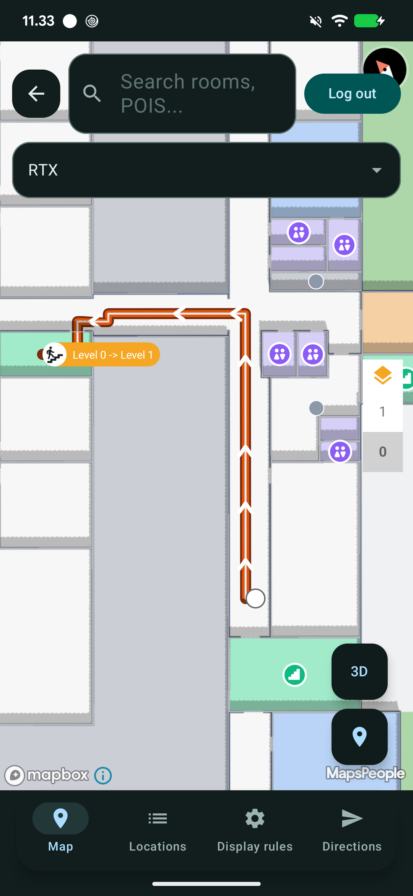
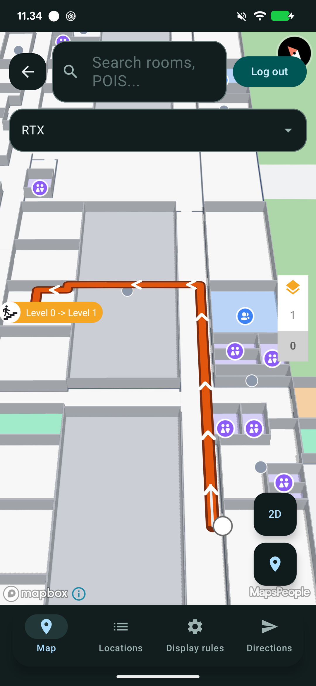

# Styling the Route

The Android SDK applies the same three-layer route styling as the Web and iOS SDKs, on both map providers (Google Maps and Mapbox). It is available from SDK 4.19.0, and the styling types on this page live in the `com.mapsindoors.core` package. Route styling resolves in three layers, and the more specific layer wins:



## Built-in defaults

The SDK's own look: a solid `#3071D9` line with a flowing animation that shows the direction of travel. Always present, so a route renders even when nothing else is configured.



## Solution styling (CMS)

What a solution admin configures under **Solution Settings → Directions Renderer** [in the CMS](../../../../products/cms/directions-renderer.md) becomes the default for the entire solution. Every app built on the solution picks it up with no code changes.

Solutions on data format v8 or later are served a complete config, with defaults that give the standard MapsIndoors look: an opaque `#3071D9` line, a subtle halo and a continuous flow animation. Solutions on older data formats are served no config, and the renderer keeps its built-in look. You can read the served config with `MapsIndoors.getSolution()?.config?.directionsRendererConfig`.



## Runtime styling

A config you pass to `setConfig()` sits on top of the solution styling, and is gone when the app restarts.



You create the renderer from your `MapControl`. It reads the solution styling once, when it is created, and applies it automatically.


Create the `MPDirectionsRenderer` **after** MapsIndoors has loaded and `MapControl` is ready. A renderer created before the solution has loaded has no solution styling to read, and keeps the built-in look.


## Setting up

Create the renderer, then request a route and hand it to the renderer. The solution styling is applied automatically:

```kotlin
val directionsRenderer = MPDirectionsRenderer(mapControl)

val directionsService = MPDirectionsService()
directionsService.setTravelMode(MPTravelMode.WALKING)
directionsService.setRouteResultListener { route, error ->
    if (route != null) {
        directionsRenderer.setRoute(route)   // draws with the solution's styling applied
    }
}
directionsService.query(origin, destination)   // origin and destination are MPPoint
```

`setRoute()` also frames the first leg with the camera and resets the selected leg and step indices to 0.

<figure><figcaption></figcaption></figure>

## Two ways to style at runtime

Android has two runtime entry points. They cover different ground, so it helps to pick the right one up front.

|                | `setOptions(MPDirectionsRendererOptions)`                                                                                    | `setConfig(MPDirectionsRendererConfig?)`                                                                                                                                                    |
| -------------- | ---------------------------------------------------------------------------------------------------------------------------- | ------------------------------------------------------------------------------------------------------------------------------------------------------------------------------------------- |
| **Covers**     | Line colour, opacity and weight; animation speed, minimum duration and repeat flag; the animated overlay                     | Everything in the CMS Directions Renderer settings: line, halo, animation (type and overlay), direction stamps, stop icons, connector icons, start and end markers, camera and 3D elevation |
| **Precedence** | Below the solution styling. A solution's `line` and `animation` values win over these                                        | Above the solution styling                                                                                                                                                                  |
| **Shape**      | Immutable data class. Every property has a concrete default                                                                  | Sparse. Every field is nullable, and `null` means inherit                                                                                                                                   |
| **Colours**    | `@ColorInt Int`, with opacity as a separate `Float`                                                                          | Hex `String` (for example `"#3071D9"`), with opacity as a separate `Double`                                                                                                                 |
| **Revert**     | No clear method. Apply a new options object                                                                                  | `setConfig(null)` falls back to the solution styling                                                                                                                                        |
| **Read back**  | `getOptions()` returns what you last applied, or `null`                                                                      | `getConfig()` returns the effective config (runtime over solution), or `null` when neither is set                                                                                           |

Use `setConfig()` for runtime styling. `setOptions()` replaces the deprecated `setPolylineColors()` and `setAnimatedPolyline()` setters, and its values only show where neither the solution nor your runtime config sets the same thing.


**`setOptions()` does not override the solution styling.** When the solution serves a config (data format v8 or later), its `line` values take precedence over the `setOptions()` stroke values, and its `animation` block takes precedence over `animationSpeed` and `animationMinDuration`. Use `setConfig()` when your runtime styling needs to win.


## Overriding, reverting, and turning off

`setConfig()` takes an `MPDirectionsRendererConfig`. Every field in it is nullable:

* A value overrides.
* `null` inherits, giving the solution value or the built-in default.
* An explicit value that means "off" is a real value. For example, `Halo(enabled = false)` turns the halo off, `Animation(type = MPRouteAnimationType.NONE)` stops the animation, and `Stamp(preset = MPRouteStampType.NONE)` removes the direction stamps.
* `setConfig(null)` removes the runtime config and falls back to the solution styling.

```kotlin
// Override just the line colour. Weight, opacity and style keep their solution (or built-in) values:
renderer.setConfig(MPDirectionsRendererConfig(
    line = MPDirectionsRendererConfig.Line(strokeColor = "#00A86B")
))

// Turn off the halo, the animation and the direction stamps:
renderer.setConfig(MPDirectionsRendererConfig(
    halo = MPDirectionsRendererConfig.Halo(enabled = false),
    animation = MPDirectionsRendererConfig.Animation(type = MPRouteAnimationType.NONE),
    stamp = MPDirectionsRendererConfig.Stamp(preset = MPRouteStampType.NONE)
))

// Clear all runtime styling and go back to the solution styling:
renderer.setConfig(null)
```

`setConfig()` takes the whole runtime config. Put every override you want in a single `MPDirectionsRendererConfig` and pass it in one call.

### Which sections merge

`line`, `halo` and `legBoundaryIcons` merge field by field with the solution styling, so a one-field tweak is legal:

```kotlin
// The solution configured the halo (enabled, white, weight 3). Change ONLY the colour:
renderer.setConfig(MPDirectionsRendererConfig(
    halo = MPDirectionsRendererConfig.Halo(color = "#000000")   // enabled and weight are inherited
))
```

Every other section (`animation`, `stamp`, `stopIcons`, `startDisplayRule`, `endDisplayRule`, `camera` and `elevation`) is applied as a whole block. Supplying one replaces the solution's block entirely, so build the complete block you want.


**One difference from the Web SDK:** the Web SDK also merges `stamp`, `elevation` and the start and end display rules field by field. On Android they are whole-block.


### Reading the effective styling

`getConfig()` returns the effective config: your runtime config merged over the solution-served config, or `null` when neither is set. In Kotlin, call it as an explicit getter:

```kotlin
val effective = renderer.getConfig()
```

## Using MPDirectionsRendererOptions

`MPDirectionsRendererOptions` is an immutable data class. Every property has a concrete default, so you only name the ones you want to change:

```kotlin
renderer.setOptions(MPDirectionsRendererOptions(
    strokeColor = Color.RED,
    strokeWeight = 6f
))
```

| Property                 | Type                                          | Default                                | Notes                                                                    |
| ------------------------ | --------------------------------------------- | -------------------------------------- | ------------------------------------------------------------------------ |
| `strokeColor`            | `@ColorInt Int`                               | `#3071D9`, the MapsIndoors blue        |                                                                          |
| `strokeOpacity`          | `Float`, 0.0 to 1.0                           | `1.0`                                  |                                                                          |
| `strokeWeight`           | `Float`, dp                                   | `4.0`                                  | Google Maps only                                                         |
| `strokeStyle`            | `MPStrokeStyle` (`SOLID`, `DASHED`, `DOTTED`) | `SOLID`                                | No effect. Use `Line(strokeStyle)` with `setConfig()`                    |
| `animationSpeed`         | `Double`, metres per second                   | `300.0`                                | Ignored when the effective config has an `animation` block               |
| `animationMinDuration`   | `Double`, seconds                             | `1.2`                                  | Ignored when the effective config has an `animation` block               |
| `animationRepeating`     | `Boolean`                                     | `true`                                 |                                                                          |
| `animatedOverlayColor`   | `@ColorInt Int?`                              | `null`, which reuses `strokeColor`     | Google Maps only                                                         |
| `animatedOverlayOpacity` | `Float`, 0.0 to 1.0                           | `1.0`                                  | Google Maps only                                                         |
| `animatedOverlayWeight`  | `Float`, dp                                   | `2.0`                                  | Google Maps only                                                         |
| `fitBoundsMaxZoom`       | `Double?`                                     | `null`                                 | No effect. Use `Camera(fitBoundsMaxZoom)` with `setConfig()`             |
| `forceAnimation`         | `Boolean`                                     | `false`                                | No effect. Use `Animation(forceAnimation)` with `setConfig()`            |

Options have no animation type, so to switch the animation off, or to change it to `PULSE` or `COMET`, use `setConfig()`.

Because the object is immutable, change a value by building a new one. In Kotlin, `copy()` is handy:

```kotlin
val current = renderer.getOptions() ?: MPDirectionsRendererOptions()
renderer.setOptions(current.copy(strokeWeight = 8f))
```

`getOptions()` returns the options you most recently applied through `setOptions()`, or `null` if you have only used the deprecated setters. It is not a view of the effective styling. Use `getConfig()` for that. There is no `clearOptions()` on `MPDirectionsRenderer`, so to undo options, apply a new options object (or use `setConfig(null)` for config-based styling).

**From Java**, the generated overloaded constructors accept a leading subset of the same parameters, so to set `strokeWeight` you also pass `strokeColor` and `strokeOpacity`. `new MPDirectionsRendererOptions()` gives the defaults:

```java
renderer.setOptions(new MPDirectionsRendererOptions(Color.RED, 1.0f, 6.0f));
```

## Common tasks

### Restyle the line for a mode, then restore it

```kotlin
// Emergency mode
renderer.setConfig(MPDirectionsRendererConfig(
    line = MPDirectionsRendererConfig.Line(strokeColor = "#B22C2C", strokeStyle = MPStrokeStyle.DASHED)
))

// Back to the solution's styling
renderer.setConfig(null)
```

### Style the halo

A contrasting outline drawn beneath the line so it stays readable over busy floor plans. The halo weight is added to each side of the line:

```kotlin
renderer.setConfig(MPDirectionsRendererConfig(
    halo = MPDirectionsRendererConfig.Halo(enabled = true, color = "#FFFFFF", opacity = 1.0, weight = 3.0)
))
```

### Change or style the animation

```kotlin
renderer.setConfig(MPDirectionsRendererConfig(
    animation = MPDirectionsRendererConfig.Animation(
        type = MPRouteAnimationType.COMET,
        speed = 400.0,              // screen pixels per second
        minAnimationTime = 1.5,     // seconds, per leg
        overlay = MPDirectionsRendererConfig.Overlay(strokeColor = "#FFFFFF", strokeOpacity = 0.9, strokeWeight = 3.0)
    )
))
```

The available types are `FLOW`, `PULSE`, `COMET` and `NONE`. `speed` is in screen pixels per second, so the animation reads the same at every zoom level. Note that this differs from `animationSpeed` in `MPDirectionsRendererOptions`, which is in metres per second.

Route animation respects the system "remove animations" (reduce motion) accessibility setting. To keep it running regardless, for example on kiosks and signage, set `forceAnimation`:

```kotlin
renderer.setConfig(MPDirectionsRendererConfig(
    animation = MPDirectionsRendererConfig.Animation(
        type = MPRouteAnimationType.FLOW,
        forceAnimation = true
    )
))
```

Note that `animation` is a whole block, so repeat the `type` when you set `forceAnimation`.

### Add direction stamps along the line

A small marker repeated along the route. Use either a built-in arrow preset or a custom icon:

```kotlin
// Built-in arrow
renderer.setConfig(MPDirectionsRendererConfig(
    stamp = MPDirectionsRendererConfig.Stamp(
        preset = MPRouteStampType.ARROW,
        arrowStyle = MPRouteArrowStyle.CHEVRON_DOUBLE,
        color = "#FFFFFF",
        spacingPx = 80.0,
        scale = 1.0
    )
))

// Custom icon
renderer.setConfig(MPDirectionsRendererConfig(
    stamp = MPDirectionsRendererConfig.Stamp(
        iconUrl = "https://example.com/stamp.png",
        spacingPx = 80.0
    )
))
```

The arrow styles are `CHEVRON` (also the fallback), `CHEVRON_DOUBLE`, `TRIANGLE`, `ARROW` and `DART`.

### Put markers on the route's origin and destination

Start and end display rules are whole-block, so build the complete rule for each:

```kotlin
renderer.setConfig(MPDirectionsRendererConfig(
    startDisplayRule = MPDirectionsRendererConfig.TerminiDisplayRule(
        icon = "https://example.com/start.png",
        label = "You are here",
        zoomFrom = 16.0,
        zoomTo = 24.0
    ),
    endDisplayRule = MPDirectionsRendererConfig.TerminiDisplayRule(
        icon = "https://example.com/destination.png",
        label = "Destination"
    )
))
```

Size an icon with `iconSize = MPDirectionsRendererConfig.IconSize(width = 32.0, height = 32.0)`, which is in density-independent pixels (dp). Use `iconVisible` and `labelVisible` to hide either part. Label styling is a nested `labelStyle` object:

```kotlin
labelStyle = MPDirectionsRendererConfig.TerminiLabelStyle(
    textSize = 14.0,
    textColor = "#1A1A1A",
    haloColor = "#FFFFFF",
    haloWidth = 1.5
)
```

### Set icons for floor changes

An icon at each point where the route changes floor, chosen by connector type:

```kotlin
renderer.setConfig(MPDirectionsRendererConfig(
    legBoundaryIcons = MPDirectionsRendererConfig.LegBoundaryIcons(
        defaultIcon = "https://example.com/connector.png",   // any other connector type
        elevator = "https://example.com/elevator.png",
        stairs = "https://example.com/stairs.png",
        scale = 1.2                                           // one shared size for all
    )
))
```

The connector types are `elevator`, `escalator`, `stairs`, `ramp`, `wheelchairramp`, `wheelchairlift`, `ladder` and, from SDK 4.23.0, `entry`, plus `defaultIcon` for any other. Note that on Android the wheelchair property names are all lowercase. Lookup order per connector: the type's own icon, then `defaultIcon`, then the built-in marker.

`legBoundaryIcons` merges field by field, so the example above keeps any solution icons for `escalator`, `ramp` and the other types it does not name.

### Cap how far the route-fit zooms in

A short route should not zoom in disorientingly close:

```kotlin
renderer.setConfig(MPDirectionsRendererConfig(
    camera = MPDirectionsRendererConfig.Camera(fitBoundsMaxZoom = 19.0)
))
```

### Control the camera

The camera framing is controlled with methods on the renderer itself, not through the styling objects:

```kotlin
renderer.setCameraViewFitMode(MPCameraViewFitMode.NONE)   // leave the camera where it is
renderer.setCameraViewTilt(45f)                           // 0 to 90 degrees
renderer.setCameraAnimationDuration(500)                  // milliseconds; 0 or a negative value disables camera animation
```

`setRoute()`, `selectLegIndex()`, `nextLeg()` and `previousLeg()` each frame the selected leg with the camera. From SDK 4.23.0, each takes an optional `onCameraEvent` listener that is called once, on the main thread, with `MPCameraEvent.FINISHED` or `MPCameraEvent.CANCELLED` (`MPCameraEvent` is in the `com.mapsindoors.core.models` package).

### Elevate the route in 3D (Mapbox v11)

```kotlin
renderer.setConfig(MPDirectionsRendererConfig(
    elevation = MPDirectionsRendererConfig.Elevation(elevated = true, heightMeters = 10.0)
))
```

Only visible with a tilted camera and a meaningful height. The `0.3` m default reads as flat, so raise it toward the CMS maximum of `10` m to see the effect clearly. Mapbox v11 only; Google Maps ignores it.

<figure><figcaption></figcaption></figure>

### Show or hide the whole route

The renderer has no visibility toggle. `clear()` removes the route from the map, and calling `setRoute()` again draws it, with the selected leg and step reset to 0.

```kotlin
renderer.clear()
```

### Custom stop icons on multi-stop routes

Request a multi-stop route with `directionsService.query(from, to, stops, optimize)`. The built-in pin is `MPRouteStopIconConfig`, which you create with its builder. It supports numbering, a colour and a label under the pin:

```kotlin
val stopIcon = MPRouteStopIconConfig.Builder(context)
    .setNumbered(true)
    .setColor(Color.BLUE)
    .build()

// A default for every stop that doesn't have its own:
renderer.setDefaultRouteStopIconConfig(stopIcon)

// Or per stop index, when you set the route (any MPRouteStopIconProvider works):
renderer.setRoute(route, mapOf(1 to providerA, 2 to providerB))
```

`setColor()` accepts either a `@ColorInt Int` or a colour `String`, and `setLabel()` adds a label under the pin. The stop-icon block of `MPDirectionsRendererConfig` (`StopIcons`) covers numbering, colour, a custom `iconUrl` and a `scale`.


Once you call `setDefaultRouteStopIconConfig()` on a renderer, even with `null`, that renderer ignores the `stopIcons` block from the solution and from `setConfig()`. Passing `null` hides the default stop markers.


## When each option takes effect

| Takes effect                             | How                                                                                                                                                                                                 |
| ---------------------------------------- | --------------------------------------------------------------------------------------------------------------------------------------------------------------------------------------------------- |
| Immediately, in place                    | Anything applied with `setOptions()` or `setConfig()` re-styles a route that is already displayed. If no route is displayed yet, apply the styling before `setRoute()` so the first render uses it. |
| When the camera frames a leg             | The `fitBoundsMaxZoom` cap applies when `setRoute()`, `selectLegIndex()`, `nextLeg()` or `previousLeg()` frames the selected leg.                                                                   |
| On the renderer, not the styling objects | `setCameraViewFitMode()`, `setCameraViewTilt()`, `setCameraAnimationDuration()`, `setDefaultRouteStopIconConfig()` and the `icons` argument of `setRoute()`.                                        |

## Engine differences

Both map engines render the same styling, with these exceptions:

* **3D elevation needs Mapbox v11.** On Google Maps the `elevation` block is ignored and the route stays flat.
* **Dashed lines render solid on Google Maps.** Google Maps has no native dashed polyline, so `DASHED` falls back to `SOLID`. `DOTTED` renders on both engines.
* **The halo default differs.** On Mapbox, a halo is drawn unless `enabled` is explicitly `false`; without a `color`, it is a faint (0.3 opacity) version of the line colour. On Google Maps, a halo is only drawn when `enabled` is `true`. Set `enabled` explicitly to get the same result on both.
* **Custom stamp icons work on both engines.** Unlike the Web SDK, a custom stamp `iconUrl` is not dropped on Google Maps.
* **Some `MPDirectionsRendererOptions` values are Google Maps only.** Mapbox does not read `strokeWeight` or the `animatedOverlay*` values. Use `Line(strokeWeight)` and `Animation(overlay)` with `setConfig()` instead.

## Value formats

* `setConfig()` colours are hex strings such as `"#3071D9"`. `setOptions()` colours are `@ColorInt` values such as `Color.RED`. In both, opacity is its own 0.0 to 1.0 field.
* Numeric types differ between the two APIs, and Kotlin does not convert between them. `MPDirectionsRendererOptions` uses `Float` for weights and opacities (`6f`), while every number in `MPDirectionsRendererConfig` is a `Double` (`8.0`).
* Line, halo and overlay weights, and `IconSize` width and height, are density-independent pixels (dp).
* Icon URLs are strings. Use absolute `https` URLs.
* Zoom levels, such as `zoomFrom`, `zoomTo` and `fitBoundsMaxZoom`, are `Double`.

## Migrating from the deprecated setters

`setPolylineColors()` and `setAnimatedPolyline()` are deprecated in favour of `setOptions()`. They remain functional.

* `setPolylineColors(foreground, background)`: `background` is the static route line and maps to `MPDirectionsRendererOptions.strokeColor`. `foreground` is the animated line drawn on top and maps to `animatedOverlayColor`. Halo (casing) styling is available through `MPDirectionsRendererConfig.Halo`.
* `setAnimatedPolyline()` took a fixed duration per leg. Animation timing is now speed-based, with a constant speed and a minimum duration, so there is no direct equivalent of a fixed duration. Use `animationSpeed` and `animationMinDuration` for timing, `animationRepeating` for the repeat flag, and `MPRouteAnimationType.NONE` through `setConfig()` to switch the animation off.
