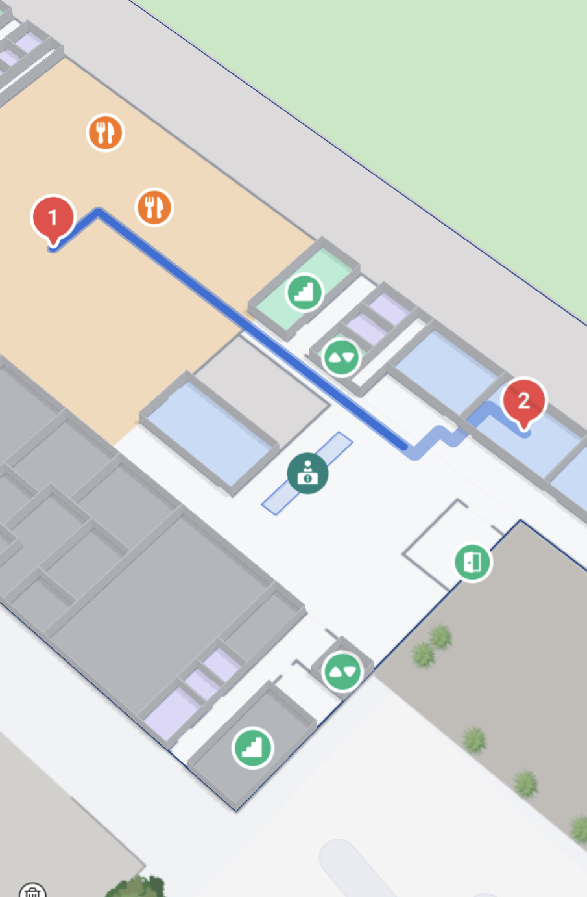
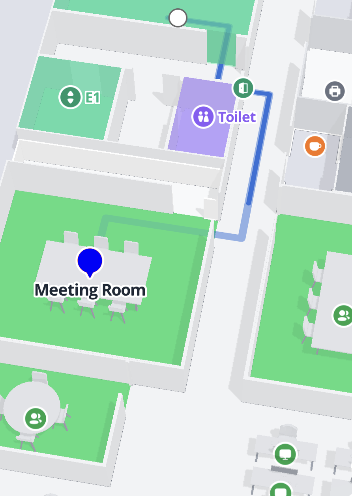

# Using multi-stop navigation

### Querying a multi-stop route

To query a multistop route a new overload `MPDirectionsService.query` has been introduced `MPDirectionsService.query(from: MPPoint, to: MPPoint, stops: List<MPPoint>?, optimize: Boolean?)`.

```kotlin
private val directionsService = MPDirectionsService()

// Example of querying an optimized route with multiple stops
fun getRoute() {
    // Setting listener to receive the queried route
    directionsService.setRouteResultListener { result, error ->
        val route = result?.routes?.firstOrNull()
        if (error == null && route != null) {
            // Route is received
        } else {
            Log.i("Directions", "Error: $error")
        }
    }
    // Creating variables to use for the query
    val origin = MPPoint(57.05800975, 9.949916517)
    val destination = MPPoint(57.058278, 9.9512196, 10.0)
    val stops = listOf(MPPoint(57.0582701, 9.9508396, 0.0), MPPoint(57.0580431, 9.9505475, 0.0), MPPoint(57.0580843, 9.9506085, 10.0))

    directionsService.query(origin, destination, stops, true)
}
```

### Showing and configuring a multi-stop route on the map

With the introduction of the multi-stop routes. There has also been added new functionality to the `MPDirectionsRenderer` to facilitate the new multi-stop routes.

You can still render the route as a Route with stops, using `setRoute(route: MPRoute)` on the DirectionsRenderer. But the interface of the `MPDirectionsRenderer` has been expanded with a `defaultStopIcon` as well as an overload of: `setRoute(route: MPRoute, icons: Map<Int, MPRouteStopIconProvider>?)`&#x20;

<figure><figcaption><p>By default route stops will be shown as a red pin with numbers</p></figcaption></figure>

The `defaultStopIcon` can be configured to show any image. It can also be set to null, to not show any icon for the stops on the Route. We supply the `MPRouteStopIconConfig` that allows you to customize the default pin to fit your application.&#x20;

```kotlin
// Changing the default icon to be blue, with a Meeting Room label and with no number inside the pin
val defaultRouteStopIcon = MPRouteStopIconConfig.Builder(this)
    .setColor(Color.BLUE)
    .setNumbered(false)
    .setLabel("Meeting Room")
    .build()
directionsRenderer?.setDefaultRouteStopIconConfig(defaultRouteStopIcon)
```


<figure><figcaption><p>Customized MPRouteStopIcon</p></figcaption></figure>

To use your own images, you can extend the MPRouteStopIconProvider with your own class. Here is an example using a bitmap for the image

```kotlin
class BitmapRouteStopIcon(private val image: Bitmap) : MPRouteStopIconProvider() {
    override fun getImage(): Bitmap = image
}
```

#### Adding a custom image to a specific waypoint

It is also possible to render an image specific to a single stop. By using `setRoute(route: MPRoute, icons: Map<Int, MPRouteStopIconProvider>?)`

```kotlin
val stopIcons = mapOf(2 to MPRouteStopIconConfig.Builder(this).setColor(Color.BLUE).build())
directionsRenderer?.setRoute(route, stopIcons)
```

Here we will show a blue icon for the third stop. Leaving the first two indexes out of the map means that the renderer will use the `defaultStopIcon`. If you want to render a specific known stop on an optimized route. You can find the ordering of the stops on an optimized route through `MPRoute.orderedStopIndexes`.
