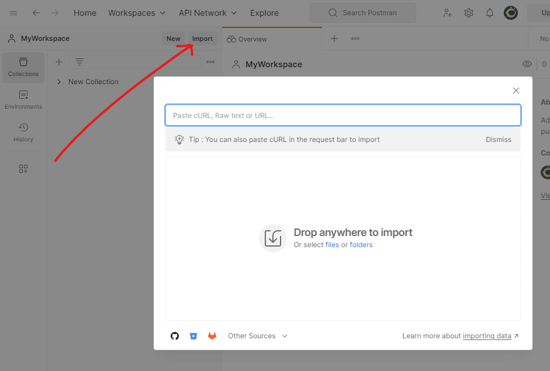
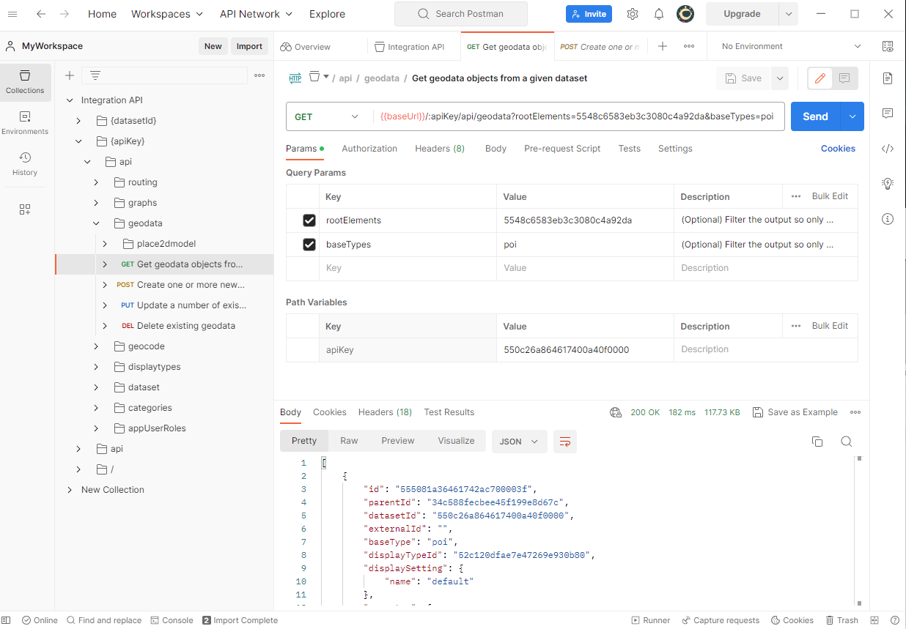

# Access with Postman

### Setting up access using Postman​ 

As an alternative to use Swagger, the integration API can be accessed via [Postman](https://www.postman.com/) by importing the swagger definition. Postman is a free of charge tool and can either be [downloaded as a standalone tool](https://www.postman.com/downloads) or you can create a new user (for free) and [use it online](https://web.postman.co/home).

Either way, you will need to do three things before starting using Postman: Importing the REST MapsIndoors Integration API definition, tell postman where to make it's calls and finally set up Autorization for it.

#### Importing to Postman​ 

The first thing you need before getting started is importing the Mapsindoors Integration API definition to Postman. First click import, paste this link and click import:

> [https://integration.mapsindoors.com/swagger/v1/swagger.json](https://integration.mapsindoors.com/swagger/v1/swagger.json)

<figure><figcaption></figcaption></figure>

#### Direct Postman to the API.​ 

Now a new collection called "Integration API" will be created. Select it and change the Variable "baseUrl" to: [https://integration.mapsindoors.com](https://integration.mapsindoors.com/)

> _**NOTE:**_ ⚠️ Remember to save changes! click the floppy disk icon.

!\[Postman BaseVariable]\(\{{ site.url \}}/assets/api/v1/postmanbasevariable.png)

<figure><figcaption></figcaption></figure>

#### Setup Postman authorization​ 

Finally we need to set authorization up for it. Go to the Authorization tab and change "Type" from No Auth to OAuth2. Here select Client Credentials as Grant Type.

Now set the:

* "Access Token URL" to `https://auth.mapsindoors.com/connect/token`
* "Client ID" to your own client ID (ask [MapsPeople support](https://mapspeople.com/support) if you don't have one)
* "Client Secret" to your client secret
* Scope to `integration`

Click "Get New Access Token" and Postman will log in with your client ID and client secret. Be sure to save your changes again by clicking the floppy disk icon.

<figure><figcaption>
Client Credential Flow example
</figcaption></figure>

To get a client ID and create a client secret, see the client credentials flow:


[client-credentials-flow.md](client-credentials-flow.md)



**Older method, being retired: username and password.** Setting the Grant Type to Password Credentials, with the client ID `client` and your CMS username and password, still works for now, but this method is being retired. Use your own client ID and client secret as shown above.


You should now be able to access your MapsIndoors data in Postman.

<figure><figcaption></figcaption></figure>

<figure><figcaption></figcaption></figure>
