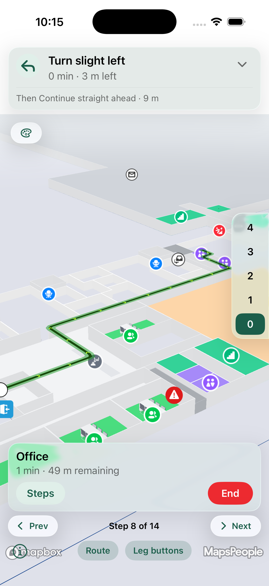

# Styling the Route

The iOS SDK applies the same three-layer styling as DisplayRules, on both providers (Google Maps and Mapbox v11). Route styling resolves in three layers, and the more specific layer wins:



## Built-in defaults

The SDK's own look — a solid `#3071D9` line, 4 px wide, with a flowing animation showing the direction of travel. Always present, so an unstyled solution renders exactly as routes always have.



## Solution styling (CMS)

What a solution admin configures under **Solution Settings → Directions Renderer** [in the CMS](../../../../products/cms/directions-renderer.md) becomes the default for the entire solution. Every app built on that solution picks it up automatically, with no code changes.



## Runtime options

Anything you set in code overrides both layers beneath it, and resets when the app restarts.



You obtain the renderer from your `MPMapControl`; it reads the solution's styling once, at construction, and applies it automatically. Runtime overrides are set through an `MPDirectionsRendererOptions` object.

## Setting up

The renderer reads the solution's styling once, at construction — so get it from your `MPMapControl` after MapsIndoors has loaded, compute a route, and render; the styling applies automatically:

```swift
let renderer = mapControl.newDirectionsRenderer()

let query = MPDirectionsQuery(originPoint: origin, destinationPoint: destination)
query.travelMode = .walking

if let route = try await MPMapsIndoors.shared.directionsService.routingWith(query: query) {
    renderer.route = route
    renderer.render()   // draws with the solution's directions-renderer styling applied
}
```

<figure><figcaption></figcaption></figure>

## Overriding, reverting, and turning off

Assign an `MPDirectionsRendererOptions` to override the solution styling, per property. iOS uses a single token — `nil` — rather than the Web SDK's `undefined`/`null` split:

* A value overrides.
* `nil` inherits — the CMS value, or the built-in default.
* An explicit value that means "off" is a real value — e.g. `backgroundColorEnabled = false` turns the halo off, `animationType = MPRouteAnimationType.none` stops the animation.
* A fresh `MPDirectionsRendererOptions()` clears every override at once.

Note the property naming: the halo is exposed as the `backgroundColor*` properties (`backgroundColorEnabled` / `backgroundColor` / `backgroundColorOpacity` / `backgroundColorWeight`). Numeric and boolean options are `NSNumber?` so `nil` can mean "inherit".

```swift
// Override just the line — every other property stays nil, so it inherits the CMS / built-in:
renderer.options = MPDirectionsRendererOptions(strokeColor: .systemGreen, strokeStyle: .dashed)

// Enable and style the halo (the backgroundColor* properties):
renderer.options = MPDirectionsRendererOptions(
    backgroundColorEnabled: NSNumber(value: true),
    backgroundColor: .white,
    backgroundColorWeight: NSNumber(value: 3))

// Turn the animation off explicitly:
renderer.options = MPDirectionsRendererOptions(animationType: MPRouteAnimationType.none)

// Clear all overrides — back to the CMS styling / built-in defaults:
renderer.options = MPDirectionsRendererOptions()
```


**Assign a new object — don't mutate in place.** The `renderer.options` getter returns a fresh, fully-resolved snapshot (your override → CMS → built-in default), so writing back into it does nothing:


```swift
// No effect — you are mutating a throwaway snapshot:
renderer.options.strokeColor = .systemGreen        // ignored

// Correct — build a new object and assign it:
renderer.options = MPDirectionsRendererOptions(strokeColor: .systemGreen)
```

Reading `renderer.options` is how you inspect the effective style — each property resolved override → CMS → built-in default. (A whole-object round-trip — `var o = renderer.options; …; renderer.options = o` — freezes the current effective values as overrides.)

## Per-property inheritance

There is no nested-block merge step. Every scalar property resolves independently — set the ones you want and leave the rest `nil`; each `nil` property inherits from the CMS, else the built-in default. So a one-field tweak is simply:

```swift
// Change only the line colour; weight, style, halo, animation … keep their CMS/built-in values:
renderer.options = MPDirectionsRendererOptions(strokeColor: .black)
```


**One difference from the Web SDK:** the three composite properties — `startDisplayRule`, `endDisplayRule` and `legBoundaryIcons` — are applied as whole objects. Setting one replaces the corresponding CMS object entirely (there is no field-level merge with the CMS rule), so build the complete object you want.


## Common tasks

### Restyle the line for a mode, then restore it

```swift
// Emergency mode
renderer.options = MPDirectionsRendererOptions(strokeColor: .systemRed, strokeStyle: .dashed)

// Back to the solution's styling (a fresh object clears the overrides)
renderer.options = MPDirectionsRendererOptions()
```

### Put markers on the route's origin and destination

Icon-backed, so they appear on the next render:

```swift
renderer.options = MPDirectionsRendererOptions(
    startDisplayRule: MPRouteMarkerDisplayRule(
        iconUrl: URL(string: "https://example.com/start.png"),
        label: "You are here",
        zoomFrom: NSNumber(value: 16), zoomTo: NSNumber(value: 24)),
    endDisplayRule: MPRouteMarkerDisplayRule(
        iconUrl: URL(string: "https://example.com/destination.png"),
        label: "Destination"))
```

Marker icons use `iconUrl` (an absolute `https` URL). Size with `iconSize` (a `CGSize`) — it overrides the shared 24 pt base. Label styling is flat on the rule (`labelTextSize` / `labelTextColor` / `labelHaloColor` / `labelHaloWidth`); there is no nested `labelStyle` object.

### Set icons for floor changes

Icon-backed; appear on the next render:

```swift
renderer.options = MPDirectionsRendererOptions(
    legBoundaryIcons: MPLegBoundaryIcons(
        defaultIcon: URL(string: "https://example.com/connector.png"),  // any other connector type
        elevator: URL(string: "https://example.com/elevator.png"),
        stairs: URL(string: "https://example.com/stairs.png"),
        scale: 1.2))                                                     // one shared size for all
```

Lookup order per connector: the type's own icon → `defaultIcon` → no marker. Property names are camelCase (`wheelchairRamp`, `wheelchairLift`) even though the CMS keys are lowercase.

### Cap how far the route-fit zooms in

```swift
renderer.options = MPDirectionsRendererOptions(fitBoundsMaxZoom: NSNumber(value: 19))
```

### Elevate the route in 3D (Mapbox v11)

```swift
renderer.options = MPDirectionsRendererOptions(
    elevated: NSNumber(value: true),
    elevationHeight: NSNumber(value: 12))
```

Only visible with a tilted (pitched) camera and a meaningful height — the 0.3 m default reads as flat; 10–15 m demos well. Mapbox v11 only; Google Maps iOS ignores it.

<figure><figcaption></figcaption></figure>

### Show or hide the whole route

Without discarding it:

```swift
renderer.isRouteVisible = false   // hide — isRouteShown stays true, the selected leg/step are kept
renderer.isRouteVisible = true    // show again
```

This is distinct from `clear()`, which removes the route entirely.

### Custom stop icons on multi-stop routes

The built-in pin is `MPRouteStopIconConfig` (numbering, colour, scale, or a custom image). Supply your own with a default for all stops, or per stop index — any type conforming to `MPRouteStopIconProvider` (a single `image`) works:

```swift
// A default for every stop that doesn't have its own:
renderer.defaultRouteStopIcon = MPRouteStopIconConfig(numbered: true, color: .systemBlue)

// Or per stop index:
renderer.render(stopIcons: [1: myProvider, 2: myProvider])
```

Set `defaultRouteStopIcon = nil` to hide the default stop markers.

## When each option takes effect

| Takes effect                             | How                                                                                                                                                                                                                                                                       |
| ---------------------------------------- | ------------------------------------------------------------------------------------------------------------------------------------------------------------------------------------------------------------------------------------------------------------------------- |
| Immediately, in place (no camera re-fit) | Assigning `renderer.options` restyles the rendered route at once — the scalar properties: `strokeColor`/`strokeOpacity`/`strokeWeight`/`strokeStyle`, the halo `backgroundColor*` set, the `animation*` set, the `stamp*` set, and `elevated`/`elevationHeight` (Mapbox). |
| On the next render — async icon fetch    | Icon-backed options — `startDisplayRule`, `endDisplayRule`, `legBoundaryIcons`, and a custom `stampImage` — download their images and appear once resolved.                                                                                                               |
| When you call `render()`                 | The camera re-fit — `fitBoundsMaxZoom` / `fitBoundsPadding` apply on the fit. Setting `options` restyles in place without re-fitting; call `render()` to also re-fit (and restore the floor).                                                                             |
| On the renderer, not options             | Visibility (`isRouteVisible`) and stop icons (`defaultRouteStopIcon` / `render(stopIcons:)`).                                                                                                                                                                             |

## Engine differences

Both providers render the same styling; the iOS-specific differences worth knowing:

* **Google Maps — silent fallbacks.** 3D elevation is ignored (no line-elevation API in the Google Maps iOS SDK) and a dashed line renders solid (no native dashed polyline; a one-time log is emitted). Neither is surfaced at runtime.
* **Custom stamp icons work on both engines.** Unlike the Web SDK, a custom stamp icon is not dropped on Google — iOS draws it as flat markers rotated to the line bearing. Only the built-in arrow uses the vector path.
* **Dashed and dotted lines.** Mapbox renders both natively (dash array). Google renders dotted as a repeating dot sprite; dashed falls back to solid.
* **3D elevation needs Mapbox v11.** Google iOS renders the route flat regardless of `elevated`.

## Value formats

* Colours are `UIColor` values (the SDK maps the CMS's 6-digit hex to `UIColor`); pass a `UIColor` in code.
* Icon URLs are absolute `https` `URL` values.
* Numeric and boolean options are `NSNumber?` (e.g. `NSNumber(value: 19)`, `NSNumber(value: true)`) so `nil` can mean "inherit".
* Enum options have a typed Swift form (`strokeStyle`, `animationType`, `stampType`, `arrowStyle`) that the initializer takes.
